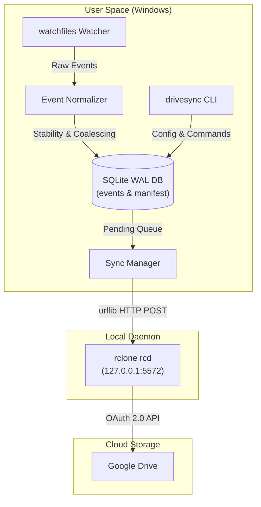

# DriveSync 🔄

> **Lightweight, Zero-Admin Windows Background Continuous Folder Sync to Google Drive**

DriveSync is an always-on Windows background service that continuously monitors local folders using `watchfiles` (Rust-backed watcher), queues normalized events into an SQLite database (WAL mode), and synchronizes them to Google Drive via `rclone`'s local authenticated Remote Control (RC) HTTP API.

---

## 🌟 Key Architecture & Highlights

- **🔒 Zero Admin Privileges Required**: Installs, executes, and configures automatic Windows startup completely in user space (`%LOCALAPPDATA%\DriveSync` and HKCU registry/Startup folder). Never triggers elevation prompts.
- **⚡ Real-Time Monitoring & Debounce Coalescing**: Uses `watchfiles` for instant change detection. Applies a ~1s stability check and coalesces rapid atomic file saves (`Delete + Add -> Modify`, `Add + Delete -> Drop`).
- **💾 Crash-Resilient SQLite Persistence**: Runs with `PRAGMA journal_mode=WAL;`. Automatically recovers interrupted `PROCESSING` tasks after system crashes or forced kills (`startup_recovery()`).
- **🛡️ Safety Circuit Breaker**: Prevents catastrophic remote wipes. If a deletion batch exceeds 50 files or 20% of tracked files (e.g. unmounted network share), sync automatically halts and requires CLI approval (`drivesync circuit-breaker approve`).
- **🌐 Authenticated Local rclone Daemon**: Launches and supervises a local `rclone rcd` background process bound to `127.0.0.1` with auto-generated HTTP Basic Auth credentials using Python stdlib `urllib`.
- **🧰 Subcommand CLI**: Comprehensive command-line interface for login, folder management, autostart, service status, logs, circuit breaker approval, and diagnostic health checks (`drivesync doctor`).

---

## 🏗️ Architecture & Data Flow



---

## 🚀 Installation & Quickstart

### Prerequisites
- **Windows 10 / 11**
- **Python 3.11+**
- **rclone binary** (`rclone.exe`)

### 1. Install DriveSync (No Elevation Required)
From the repository root, install the package in editable mode:

```cmd
pip install -e .
```

### 2. Authenticate with Google Drive
DriveSync delegates Google OAuth consent entirely to `rclone`. Your credentials are never handled by DriveSync directly:

```cmd
drivesync auth login
```
*Your browser will open automatically to complete Google Drive authorization.*

Verify login status:
```cmd
drivesync auth status
```

### 3. Register Folders to Sync
Register one or more local folders. You can optionally specify a remote destination path on Google Drive:

```cmd
drivesync folders add "C:\Users\YourUser\Documents\Projects" --remote-path "DriveSync/Projects"
```

List registered folders:
```cmd
drivesync folders list
```

### 4. Start the Background Service
Start the background sync daemon:

```cmd
drivesync start
```

Inspect service health and queue status:
```cmd
drivesync status
```

Stop the background service:
```cmd
drivesync stop
```

### 5. Enable Windows Autostart
Enable DriveSync to launch automatically at Windows user login (zero admin rights required):

```cmd
drivesync autostart enable
```

Check autostart status:
```cmd
drivesync autostart status
```

---

## 💻 Deploying Standalone Windows `.exe` (Zero Dependencies)

DriveSync can be compiled into a standalone, single-file Windows executable (`drivesync.exe`) that runs on **any Windows PC without requiring Python or any dependencies to be preinstalled**!

### Option A: Use the Compiled `drivesync.exe`
1. Copy `dist/drivesync.exe` to any folder on the new Windows PC (e.g. `%LOCALAPPDATA%\DriveSync` or `C:\Tools\drivesync.exe`).
2. Run directly from CMD or PowerShell:
   ```cmd
   drivesync.exe auth login
   drivesync.exe folders add "C:\Users\YourUser\Documents\Folder"
   drivesync.exe start
   drivesync.exe autostart enable
   ```
   *`drivesync.exe` will automatically download `rclone.exe` on first launch if not found!*

### Option B: Build Your Own `drivesync.exe`
To compile the single-file executable from source:
```cmd
python build_exe.py
```
Output executable is generated at `dist/drivesync.exe`.

---

## 💻 CLI Subcommand Reference

| Command | Subcommand / Action | Description |
| :--- | :--- | :--- |
| **`drivesync auth`** | `login [--remote-path NAME]` | Launch Google Drive OAuth consent flow via rclone. |
| | `status` | Test and verify Google Drive remote authorization state. |
| | `clear` | Purge stored Google Drive credentials from rclone configuration. |
| **`drivesync folders`** | `add <path> [--remote-path PATH]` | Register a local folder for continuous synchronization. |
| | `remove <path>` | Unregister a local folder from sync. |
| | `list` | Display a formatted table of all watched folders and remote paths. |
| **`drivesync start`** | — | Launch background service daemon (`drivesync.daemon`). |
| **`drivesync stop`** | — | Send termination signal to running background daemon process. |
| **`drivesync status`** | — | Show daemon PID, watched folder count, queue metrics, and breaker status. |
| **`drivesync resync`** | `[path]` | Trigger a manual 2-Way `rclone bisync --resync` baseline run on demand. |
| **`drivesync trash`** | `list \| clear` | Manage local safety trash folder (`%LOCALAPPDATA%\DriveSync\Trash`). |
| **`drivesync autostart`** | `enable \| disable \| status` | Manage HKCU Windows registry Run key autostart. |
| **`drivesync circuit-breaker`** | `approve \| status \| reset` | Inspect or clear safety circuit breaker after mass deletion halts. |
| **`drivesync doctor`** | — | Run 7-point diagnostic health suite (rclone binary, DB WAL, disk space, etc.). |
| **`drivesync logs`** | `[--tail N]` | View recent service logs from `%LOCALAPPDATA%\DriveSync\logs\drivesync.log`. |

---

## 🛡️ Safety Mechanisms & Policies

### Circuit Breaker Protection
If a single batch attempts to delete **>50 files** or **>20%** of total tracked manifest files (e.g. an unplugged external drive or network share drop), sync processing halts immediately and logs a `CRITICAL` alert.

To approve mass deletions and resume sync:
```cmd
drivesync circuit-breaker approve
```

### Conflict Resolution Policy
DriveSync implements **Last-Write-Wins by `mtime`** as its default conflict policy for remote and local file modifications.

---

## 📂 Data & Configuration Locations

All DriveSync files reside exclusively in user space:

- **Base Directory**: `%LOCALAPPDATA%\DriveSync\`
- **Configuration**: `%LOCALAPPDATA%\DriveSync\config.json`
- **Database (WAL)**: `%LOCALAPPDATA%\DriveSync\drivesync.db`
- **PID File**: `%LOCALAPPDATA%\DriveSync\drivesync.pid`
- **Service Logs**: `%LOCALAPPDATA%\DriveSync\logs\drivesync.log`

---

## 🧪 Test Suite & Chaos Verification

DriveSync includes a 18-test suite covering unit components, live Google Drive sync, and 6 real-life chaos scenarios:

```cmd
python -m unittest discover -s tests -p "test_*.py"
```

### Verified Chaos Scenarios ([tests/test_chaos.py](file:///d:/dev/drivesync/tests/test_chaos.py))
1. **Rapid-Fire Save Churn**: `<50ms` rapid modifications/deletions coalesce cleanly to `MODIFY` without ghost queue entries.
2. **Sudden SIGKILL Crash**: Interrupted `PROCESSING` events automatically recover to `PENDING` on startup.
3. **Accidental Mass Folder Wipe**: Breaker trips on mass deletion and resumes cleanly upon user approval.
4. **Transient Network Errors**: HTTP 429/503 errors trigger exponential backoff retries without wasting retry budget.
5. **NTFS Case-Insensitivity**: Case-differing Windows paths canonicalize to prevent duplicate remote Drive items.
6. **Offline Disk Edits**: Directory diff scan detects offline file additions, modifications, and deletions.

---

## 📌 Known Limitations & Roadmap

> [!NOTE]
> **Directory Diff Reconciliation**: On startup and periodically (default every 5 minutes), DriveSync performs a **heuristic directory diff scan** against its SQLite manifest table to catch offline changes made while the service was stopped.
>
> For typical folder volumes, this provides fast, reliable offline reconciliation. For extremely large filesystems (100,000+ files), an **NTFS USN Journal reader integration** represents the natural upgrade path for v2.
